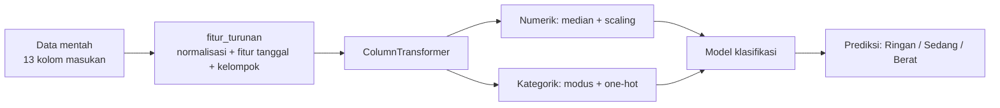

# Kasus: Prediksi Tingkat Keparahan Kecelakaan Lalu Lintas

Materi ini membahas satu kasus utuh dari data mentah sampai aplikasi: feature engineering, model klasifikasi, metrik evaluasi, deploy dengan joblib, dan aplikasi Streamlit. Dataset yang dipakai adalah `case6_traffic_accident` berisi 3.000 kejadian dengan 17 kolom.

## Daftar Isi

1. [Memahami masalah dan data](#1-memahami-masalah-dan-data)
2. [Kualitas data](#2-kualitas-data)
3. [Feature engineering](#3-feature-engineering)
4. [Model klasifikasi](#4-model-klasifikasi)
5. [Metrik evaluasi](#5-metrik-evaluasi)
6. [Deploy dengan joblib](#6-deploy-dengan-joblib)
7. [Aplikasi Streamlit](#7-aplikasi-streamlit)
8. [Struktur proyek dan cara menjalankan](#8-struktur-proyek-dan-cara-menjalankan)

---

## 1. Memahami masalah dan data

**Pertanyaan bisnis:** saat sebuah kecelakaan dilaporkan, seberapa besar kemungkinan tingkatnya Ringan, Sedang, atau Berat? Jawabannya dapat membantu petugas memprioritaskan respons.

**Target:** `tingkat_keparahan` dengan tiga kelas. Jumlahnya cukup seimbang: Ringan 1.163 (38,8%), Sedang 942 (31,4%), dan Berat 895 (29,8%).

| Kolom | Tipe | Keterangan |
| --- | --- | --- |
| `accident_id` | teks | ID unik, dipakai untuk memeriksa duplikat |
| `tanggal` | teks | Tanggal kejadian, format `YYYY-MM-DD` (2020–2024) |
| `hari` | teks | Nama hari, tidak konsisten dengan `tanggal` (lihat bagian 2) |
| `jam` | angka | Jam kejadian, 0–23 |
| `kota`, `tipe_jalan`, `kondisi_pencahayaan`, `kondisi_permukaan_jalan`, `jenis_kendaraan` | teks | Konteks lokasi dan kondisi jalan |
| `kondisi_cuaca` | teks | Kondisi cuaca, penulisannya campur (lihat bagian 2) |
| `jumlah_kendaraan_terlibat` | angka | 1–5 kendaraan |
| `batas_kecepatan_kmh` | angka | 40–100 km/jam |
| `usia_pengemudi`, `jenis_kelamin_pengemudi` | angka, teks | Data pengemudi |
| `alkohol_terdeteksi` | teks | Ya / Tidak |
| `jumlah_korban` | angka | Jumlah korban. **Tidak dipakai sebagai fitur** (lihat bagian 3.1) |
| `tingkat_keparahan` | teks | **Target** |

---

## 2. Kualitas data

Pemeriksaan dilakukan berurutan: duplikat, missing value, nilai tidak wajar, lalu konsistensi antarkolom.

- **Duplikat:** tidak ada. Setiap `accident_id` unik (3.000 dari 3.000).
- **Missing value:** 1.345 sel kosong dari 51.000 sel (2,6%), tersebar di 15 kolom. Kolom dengan missing terbanyak adalah `jumlah_korban` (129) dan `alkohol_terdeteksi` (124).
- **Nilai tidak wajar:** rentang angka masuk akal. `jam` 0–23, `usia_pengemudi` 17–72, `batas_kecepatan_kmh` 40–100.
- **Penulisan kategori:** `kondisi_cuaca` punya 20 penulisan. Ada huruf kapital dan kecil yang bercampur (`CERAH`, `cerah`), dan ada simbol `@` sebagai pengganti huruf (`Ber@w@n`, `Huj@n Leb@t`). Setelah dinormalkan, hanya tersisa 5 kategori: Berawan, Berkabut, Cerah, Hujan Lebat, dan Hujan Ringan.
- **Konsistensi `hari`:** nilai `hari` hanya cocok dengan nama hari dari `tanggal` pada 14,1% baris. Kolom `hari` asli tidak dapat dipercaya, sehingga harinya dihitung ulang dari `tanggal`.

---

## 3. Feature engineering

### 3.1 Kebocoran data: `jumlah_korban`

Kolom `jumlah_korban` tidak boleh menjadi fitur. Kolom ini baru diketahui setelah kejadian selesai dicatat, dan secara langsung menentukan keparahan:

- Semua kejadian kelas Ringan memiliki `jumlah_korban = 0`.
- Korelasi `jumlah_korban` dengan tingkat keparahan adalah **0,817**.

Jika kolom ini dipakai, model akan terlihat sangat akurat di data uji, padahal model tidak bisa digunakan saat kejadian baru dilaporkan. Ini contoh klasik data leakage yang harus dihindari.

### 3.2 Pola yang digunakan

Fitur yang dihasilkan dari data kejadian dan kondisi di lokasi:

| Fitur | Dibuat dari | Alasan |
| --- | --- | --- |
| `hari_dari_tanggal` | `tanggal` | Menggantikan kolom `hari` yang tidak konsisten |
| `akhir_pekan` | `tanggal` | Pola lalu lintas berbeda pada akhir pekan |
| `musim` | `tanggal` | Musim hujan (November–April) dan musim kemarau |
| `kelompok_jam` | `jam` | Dini hari, pagi, siang, sore, dan malam punya kondisi lalu lintas berbeda |
| `kelompok_usia` | `usia_pengemudi` | Mengelompokkan usia menjadi rentang yang bermakna |
| `kondisi_cuaca` (bersih) | `kondisi_cuaca` | Normalisasi penulisan dan simbol |

### 3.3 Hubungan fitur dengan target

Sebelum memodelkan, periksa apakah ada sinyal. Dua contoh dari data ini:

- Pengemudi yang terdeteksi alkohol lebih sering mengalami kecelakaan Berat: **43,1%**, dibanding **26,3%** untuk yang tidak terdeteksi alkohol.
- Hujan lebat berkaitan dengan keparahan Berat (**44,1%**), dibanding cerah (**23,9%**).

Sinyal ini cukup terlihat, tetapi belum cukup untuk memisahkan ketiga kelas dengan baik. Hasilnya dibahas di bagian 5.

### 3.4 Kode feature engineering: `fitur.py`

Fungsi ini dipisah ke file sendiri agar bisa dipakai saat pelatihan dan saat aplikasi berjalan. Fungsi ini ikut tersimpan di dalam pipeline, sehingga harus bisa di-import (tidak boleh lambda, lihat bagian 6.3).

```python
"""
fitur.py
========
Pembersihan dan feature engineering. Fungsi ini dipakai di dua tempat:
1. saat pelatihan (sebagai langkah pertama pipeline),
2. saat aplikasi Streamlit membuat prediksi.

Karena fungsi ini ikut tersimpan di dalam pipeline (joblib/pickle), fungsi
harus didefinisikan di modul yang bisa di-import (bukan lambda).
"""

import numpy as np
import pandas as pd

# Kolom mentah yang dibutuhkan model (tanpa accident_id, hari, dan jumlah_korban)
KOLOM_MASUKAN = [
    "tanggal", "jam", "kota", "tipe_jalan", "kondisi_cuaca",
    "kondisi_pencahayaan", "kondisi_permukaan_jalan", "jenis_kendaraan",
    "jumlah_kendaraan_terlibat", "batas_kecepatan_kmh", "usia_pengemudi",
    "jenis_kelamin_pengemudi", "alkohol_terdeteksi",
]

# Fitur numerik dan kategorik yang masuk ke model (setelah feature engineering)
NUM = ["jam", "jumlah_kendaraan_terlibat", "batas_kecepatan_kmh", "usia_pengemudi"]
KAT = [
    "kota", "tipe_jalan", "kondisi_cuaca", "kondisi_pencahayaan",
    "kondisi_permukaan_jalan", "jenis_kendaraan", "jenis_kelamin_pengemudi",
    "alkohol_terdeteksi", "hari_dari_tanggal", "akhir_pekan", "musim",
    "kelompok_jam", "kelompok_usia",
]

KELAS = ["Ringan", "Sedang", "Berat"]

NAMA_HARI = {0: "Senin", 1: "Selasa", 2: "Rabu", 3: "Kamis", 4: "Jumat", 5: "Sabtu", 6: "Minggu"}
BULAN_MUSIM_HUJAN = [11, 12, 1, 2, 3, 4]


def fitur_turunan(df):
    """Bersihkan data mentah lalu bentuk fitur turunan. Mengembalikan DataFrame baru."""
    d = df.copy()

    # 1. Normalisasi teks: spasi, simbol '@' yang salah ketik, dan kapitalisasi
    for c in ["kota", "tipe_jalan", "kondisi_pencahayaan", "kondisi_permukaan_jalan",
              "jenis_kendaraan", "jenis_kelamin_pengemudi", "alkohol_terdeteksi"]:
        d[c] = d[c].astype("string").str.strip()
    d["kondisi_cuaca"] = (
        d["kondisi_cuaca"].astype("string").str.strip()
        .str.replace("@", "a", regex=False)     # 'Ber@w@n' -> 'Berawan'
        .str.lower().str.title()                 # 'HUJAN LEBAT' -> 'Hujan Lebat'
    )

    # 2. Fitur dari tanggal (hari dihitung ulang, karena kolom 'hari' asli tidak konsisten)
    tgl = pd.to_datetime(d["tanggal"], errors="coerce")
    d["hari_dari_tanggal"] = tgl.dt.dayofweek.map(NAMA_HARI)
    akhir = np.where(tgl.dt.dayofweek >= 5, "Akhir pekan", "Hari kerja")
    d["akhir_pekan"] = pd.Series(akhir, index=d.index).where(tgl.notna())
    musim = np.where(tgl.dt.month.isin(BULAN_MUSIM_HUJAN), "Musim hujan", "Musim kemarau")
    d["musim"] = pd.Series(musim, index=d.index).where(tgl.notna())

    # 3. Pengelompokan angka menjadi kategori yang bermakna
    d["kelompok_jam"] = pd.cut(
        d["jam"], bins=[0, 6, 11, 15, 18, 24], right=False,
        labels=["Dini hari", "Pagi", "Siang", "Sore", "Malam"],
    ).astype("object")
    d["kelompok_usia"] = pd.cut(
        d["usia_pengemudi"], bins=[0, 25, 40, 55, 200], right=False,
        labels=["<25", "25-39", "40-54", "55+"],
    ).astype("object")

    # 4. Kategori kosong dinyatakan sebagai np.nan agar SimpleImputer aman
    for c in KAT:
        d[c] = d[c].astype("object").where(d[c].notna(), np.nan)

    return d
```

---

## 4. Model klasifikasi

### 4.1 Strategi

- **Pemisahan data:** 80% train (2.400 kejadian) dan 20% test (600 kejadian), dengan `stratify` agar proporsi kelas sama.
- **Pembanding:** Logistic Regression dan Random Forest, keduanya dengan `class_weight="balanced"` agar kelas Sedang yang paling kecil tidak diabaikan.
- **Pemilihan model:** cross-validation 5 lipatan di data train, memakai metrik F1-macro.
- **Pembanding minimum:** `DummyClassifier` yang menebak sesuai proporsi kelas.
- **Evaluasi akhir:** model terpilih dilatih ulang pada seluruh data train, lalu dievaluasi sekali di data test.

### 4.2 Pipeline



### 4.3 Kode pelatihan: `latih_kecelakaan.py`

```python
"""
latih_kecelakaan.py
===================
Melatih model klasifikasi tingkat_keparahan (Ringan / Sedang / Berat),
mengevaluasinya, dan menyimpan pipeline ke models/ dengan joblib.
"""

import warnings
from pathlib import Path

import joblib
import numpy as np
import pandas as pd
import sklearn
from sklearn.compose import ColumnTransformer
from sklearn.dummy import DummyClassifier
from sklearn.ensemble import RandomForestClassifier
from sklearn.impute import SimpleImputer
from sklearn.linear_model import LogisticRegression
from sklearn.metrics import (
    accuracy_score, balanced_accuracy_score, classification_report,
    confusion_matrix, f1_score, roc_auc_score,
)
from sklearn.model_selection import cross_val_score, train_test_split
from sklearn.pipeline import Pipeline
from sklearn.preprocessing import FunctionTransformer, OneHotEncoder, StandardScaler

from fitur import KAT, KELAS, KOLOM_MASUKAN, NUM, fitur_turunan

warnings.filterwarnings("ignore")
RANDOM_STATE = 42

# --- 1. Muat data dan buang duplikat ---
df = pd.read_csv("data/traffic_accident.csv")
df = df.drop_duplicates(subset="accident_id").reset_index(drop=True)
df = df.dropna(subset=["tingkat_keparahan"])
print("Data setelah dedup:", df.shape)

X = df[KOLOM_MASUKAN]          # jumlah_korban, accident_id, dan hari TIDAK dipakai
y = df["tingkat_keparahan"]

X_train, X_test, y_train, y_test = train_test_split(
    X, y, test_size=0.2, random_state=RANDOM_STATE, stratify=y,
)

# --- 2. Preprocessing: imputasi, scaling, dan one-hot ---
prep = ColumnTransformer([
    ("num", Pipeline([
        ("imputer", SimpleImputer(strategy="median")),
        ("scaler", StandardScaler()),
    ]), NUM),
    ("kat", Pipeline([
        ("imputer", SimpleImputer(strategy="most_frequent")),
        ("ohe", OneHotEncoder(handle_unknown="ignore", sparse_output=False)),
    ]), KAT),
])

# --- 3. Bandingkan dua model dengan cross-validation di data TRAIN ---
kandidat = {
    "Logistic Regression": LogisticRegression(max_iter=2000, class_weight="balanced"),
    "Random Forest": RandomForestClassifier(
        n_estimators=300, min_samples_leaf=3, class_weight="balanced",
        random_state=RANDOM_STATE, n_jobs=-1),
}

skor_cv = {}
for nama, clf in kandidat.items():
    pipe = Pipeline([
        ("fe", FunctionTransformer(fitur_turunan)),
        ("prep", prep),
        ("clf", clf),
    ])
    skor = cross_val_score(pipe, X_train, y_train, cv=5, scoring="f1_macro")
    skor_cv[nama] = skor.mean()
    print(f"{nama:20} F1-macro CV = {skor.mean():.3f} (± {skor.std():.3f})")

nama_terpilih = max(skor_cv, key=skor_cv.get)
print("Model terpilih:", nama_terpilih)

# --- 3b. Baseline: tebakan acak sesuai proporsi kelas (pembanding minimum) ---
baseline = DummyClassifier(strategy="stratified", random_state=RANDOM_STATE)
baseline_pipe = Pipeline([("fe", FunctionTransformer(fitur_turunan)), ("prep", prep), ("clf", baseline)])
baseline_pipe.fit(X_train, y_train)
print(f"Baseline (tebakan acak) F1-macro TEST = "
      f"{f1_score(y_test, baseline_pipe.predict(X_test), average='macro'):.3f}")

# --- 4. Latih model terpilih pada seluruh data train, evaluasi sekali di TEST ---
model = Pipeline([
    ("fe", FunctionTransformer(fitur_turunan)),
    ("prep", prep),
    ("clf", kandidat[nama_terpilih]),
])
model.fit(X_train, y_train)

y_pred = model.predict(X_test)
proba = model.predict_proba(X_test)
kelas_model = list(model.classes_)

metrik = {
    "accuracy": accuracy_score(y_test, y_pred),
    "balanced_accuracy": balanced_accuracy_score(y_test, y_pred),
    "f1_macro": f1_score(y_test, y_pred, average="macro"),
    "f1_weighted": f1_score(y_test, y_pred, average="weighted"),
    "roc_auc_ovr_macro": roc_auc_score(
        y_test, proba, multi_class="ovr", average="macro", labels=kelas_model),
}
print("\n=== Metrik pada data TEST ===")
for k, v in metrik.items():
    print(f"{k:20} {v:.3f}")

print("\n=== Classification report ===")
print(classification_report(y_test, y_pred, labels=KELAS, digits=3))

cm = pd.DataFrame(
    confusion_matrix(y_test, y_pred, labels=KELAS),
    index=[f"Aktual {k}" for k in KELAS],
    columns=[f"Prediksi {k}" for k in KELAS],
)
print("=== Confusion matrix ===")
print(cm)

# --- 5. Simpan bundle dengan joblib ---
Path("models").mkdir(exist_ok=True)
Path("output").mkdir(exist_ok=True)
cm.to_csv("output/confusion_matrix.csv")

fe_df = fitur_turunan(X)
bundle = {
    "pipeline": model,
    "kolom_masukan": KOLOM_MASUKAN,
    "kelas": kelas_model,
    "opsi": {c: sorted(fe_df[c].dropna().unique().tolist())
             for c in ["kota", "tipe_jalan", "kondisi_cuaca", "kondisi_pencahayaan",
                       "kondisi_permukaan_jalan", "jenis_kendaraan",
                       "jenis_kelamin_pengemudi", "alkohol_terdeteksi"]},
    "metrik_test": {k: float(v) for k, v in metrik.items()},
    "confusion_matrix": cm,
    "model_terpilih": nama_terpilih,
    "versi_sklearn": sklearn.__version__,
}
joblib.dump(bundle, "models/keparahan_kecelakaan.joblib", compress=3)
print("\nModel tersimpan di models/keparahan_kecelakaan.joblib")
```

### 4.4 Hasil pelatihan

Hasil ini dari menjalankan skrip di atas pada dataset yang sama:

| Model | F1-macro (CV, data train) |
| --- | --- |
| Logistic Regression | 0,408 |
| Random Forest | 0,407 |

Model terpilih: **Logistic Regression**, karena skornya sedikit lebih tinggi. Selisih dengan Random Forest sangat kecil, sehingga keduanya dapat dianggap setara.

---

## 5. Metrik evaluasi

### 5.1 Metrik yang dipakai

Untuk tiga kelas, metrik yang dipakai adalah sebagai berikut:

| Metrik | Arti | Hasil di data test |
| --- | --- | --- |
| **Accuracy** | Proporsi prediksi yang benar dari semua kejadian | 0,427 |
| **Balanced accuracy** | Rata-rata recall tiap kelas, sehingga kelas kecil tidak diabaikan | 0,420 |
| **F1-macro** | Rata-rata F1 tiap kelas dengan bobot sama. Metrik utama | **0,411** |
| **F1-weighted** | Rata-rata F1 tiap kelas, dibobot jumlah data kelasnya | 0,416 |
| **ROC-AUC (OvR, macro)** | Seberapa baik model memisahkan satu kelas dari sisanya, dirata-ratakan. 0,5 berarti tebakan acak | 0,597 |

Accuracy tidak dijadikan metrik utama karena pada tiga kelas, tebakan acak sudah sekitar sepertiga benar. F1-macro lebih jujur karena memperlakukan setiap kelas dengan bobot sama.

### 5.2 Perbandingan dengan baseline

| Model | F1-macro (data test) |
| --- | --- |
| Tebakan acak sesuai proporsi kelas (baseline) | 0,360 |
| Logistic Regression | 0,411 |

Model lebih baik dari tebakan acak, tetapi selisihnya hanya sekitar 0,05. Ini berarti fitur yang tersedia hanya memberi sedikit informasi tentang keparahan.

### 5.3 Laporan per kelas

```text
              precision    recall  f1-score   support
      Ringan      0.471     0.528     0.498       233
      Sedang      0.321     0.223     0.263       188
       Berat      0.438     0.508     0.470       179
    accuracy                          0.427       600
   macro avg      0.410     0.420     0.411       600
weighted avg      0.414     0.427     0.416       600
```

### 5.4 Confusion matrix

| | Prediksi Ringan | Prediksi Sedang | Prediksi Berat |
| --- | --- | --- | --- |
| **Aktual Ringan** | 123 | 55 | 55 |
| **Aktual Sedang** | 84 | 42 | 62 |
| **Aktual Berat** | 54 | 34 | 91 |

Cara membacanya: baris adalah keparahan sebenarnya, kolom adalah prediksi model. Diagonal (123, 42, 91) adalah prediksi yang benar.

- Kelas **Sedang** paling sulit: hanya 22,3% yang terdeteksi (recall 0,223). Banyak kejadian Sedang diprediksi Ringan (84) atau Berat (62).
- Kelas **Ringan** (recall 0,528) dan **Berat** (recall 0,508) lebih baik dikenali dibanding Sedang.

### 5.5 Pembacaan hasil

Model ini lebih baik dari tebakan, tetapi belum cukup akurat untuk mengambil keputusan otomatis. Dari sepuluh kejadian yang diprediksi, sekitar empat yang benar. Penggunaan yang wajar adalah sebagai alat bantu untuk menyusun prioritas, dengan keputusan tetap di tangan petugas. Untuk meningkatkan model, data tambahan yang kemungkinan membantu adalah kecepatan kendaraan saat kejadian, lokasi tepat, dan kondisi kendaraan.

---

## 6. Deploy dengan joblib

### 6.1 Apa yang disimpan

Satu file `models/keparahan_kecelakaan.joblib` berisi bundle dictionary:

| Kunci | Isi | Dipakai untuk |
| --- | --- | --- |
| `pipeline` | Feature engineering, preprocessing, dan model | Membuat prediksi |
| `kolom_masukan` | 13 kolom mentah yang harus diisi | Menyusun input aplikasi |
| `kelas` | Urutan kelas dari model | Menampilkan probabilitas dengan benar |
| `opsi` | Pilihan kategori yang dikenal model | Mengisi dropdown aplikasi |
| `metrik_test` | Metrik di data test | Ditampilkan di tab metrik |
| `confusion_matrix` | Matriks dari data test | Ditampilkan di tab metrik |
| `versi_sklearn` | Versi library saat pelatihan | Memeriksa kecocokan versi |

Dengan menyimpan seluruh pipeline, aplikasi cukup menyediakan data mentah. Feature engineering tidak perlu diulang secara manual, sehingga tidak ada risiko perbedaan perlakuan antara pelatihan dan penggunaan.

### 6.2 Memuat dan memprediksi

```python
import joblib
import pandas as pd

bundle = joblib.load("models/keparahan_kecelakaan.joblib")

kejadian_baru = pd.DataFrame([{
    "tanggal": "2024-06-01", "jam": 22.0, "kota": "Jakarta",
    "tipe_jalan": "Jalan Tol", "kondisi_cuaca": "Hujan Lebat",
    "kondisi_pencahayaan": "Malam", "kondisi_permukaan_jalan": "Licin",
    "jenis_kendaraan": "Mobil", "jumlah_kendaraan_terlibat": 2.0,
    "batas_kecepatan_kmh": 100.0, "usia_pengemudi": 24.0,
    "jenis_kelamin_pengemudi": "Laki-laki", "alkohol_terdeteksi": "Ya",
}])[bundle["kolom_masukan"]]

proba = bundle["pipeline"].predict_proba(kejadian_baru)[0]
for kelas, p in zip(bundle["kelas"], proba):
    print(f"{kelas:8} {p:.1%}")
print("Prediksi:", bundle["kelas"][proba.argmax()])
```

### 6.3 Aturan agar deploy berjalan

1. **Modul `fitur` harus ada di folder yang sama** dengan skrip yang memuat model. Joblib menyimpan referensi ke fungsi `fitur_turunan` dan akan gagal memuat jika modul itu tidak ditemukan.
2. **Fungsi di dalam pipeline harus bisa di-import.** Jangan memakai `lambda` untuk `FunctionTransformer`, karena tidak dapat disimpan.
3. **Versi library harus sama** antara pelatihan dan deploy. Simpan versi di `requirements.txt`.
4. **Jangan memuat file joblib dari sumber yang tidak dipercaya,** karena file itu dapat menjalankan kode.

---

## 7. Aplikasi Streamlit

### 7.1 Konsep yang dipakai

- `@st.cache_resource` memuat model sekali saja, meskipun pengguna mengubah input berkali-kali.
- Input pengguna disusun menjadi satu baris DataFrame dengan nama kolom yang sama seperti saat pelatihan.
- Dropdown diisi dari `bundle["opsi"]`, sehingga pilihan yang tampil selalu sesuai dengan data latih.
- Tab metrik menampilkan hasil evaluasi yang tersimpan, sehingga pengguna dapat melihat seberapa dapat dipercaya model.

### 7.2 Kode aplikasi: `app.py`

```python
"""
app.py
======
Aplikasi Streamlit untuk memprediksi tingkat keparahan kecelakaan.
Jalankan: streamlit run app.py
"""

import datetime as dt
from pathlib import Path

import joblib
import pandas as pd
import streamlit as st

MODEL_PATH = Path(__file__).parent / "models" / "keparahan_kecelakaan.joblib"


@st.cache_resource
def load_bundle():
    if not MODEL_PATH.exists():
        return None
    return joblib.load(MODEL_PATH)   # memuat pipeline: feature engineering + model


st.set_page_config(page_title="Prediksi Keparahan Kecelakaan", layout="wide")
st.title("Prediksi Tingkat Keparahan Kecelakaan")
st.caption("Model klasifikasi: Ringan, Sedang, atau Berat. Dipakai sebagai alat bantu, bukan keputusan akhir.")

bundle = load_bundle()
if bundle is None:
    st.error("Model belum ada. Jalankan latih_kecelakaan.py terlebih dahulu.")
    st.stop()

opsi = bundle["opsi"]
tab_prediksi, tab_metrik = st.tabs(["Prediksi", "Metrik evaluasi"])

with tab_prediksi:
    kiri, kanan = st.columns(2)
    with kiri:
        tanggal = st.date_input("Tanggal kejadian", value=dt.date(2024, 6, 1),
                                min_value=dt.date(2020, 1, 1), max_value=dt.date(2024, 12, 31))
        jam = st.slider("Jam kejadian", 0, 23, 17)
        kota = st.selectbox("Kota", opsi["kota"])
        tipe_jalan = st.selectbox("Tipe jalan", opsi["tipe_jalan"])
        cuaca = st.selectbox("Kondisi cuaca", opsi["kondisi_cuaca"])
        pencahayaan = st.selectbox("Kondisi pencahayaan", opsi["kondisi_pencahayaan"])
    with kanan:
        permukaan = st.selectbox("Kondisi permukaan jalan", opsi["kondisi_permukaan_jalan"])
        kendaraan = st.selectbox("Jenis kendaraan", opsi["jenis_kendaraan"])
        jumlah_kendaraan = st.number_input("Jumlah kendaraan terlibat", 1, 5, 2)
        batas = st.number_input("Batas kecepatan (km/jam)", 40, 100, 60, step=10)
        usia = st.number_input("Usia pengemudi", 17, 72, 35)
        jk = st.selectbox("Jenis kelamin pengemudi", opsi["jenis_kelamin_pengemudi"])
        alkohol = st.selectbox("Alkohol terdeteksi", opsi["alkohol_terdeteksi"])

    if st.button("Prediksi", type="primary"):
        masukan = pd.DataFrame([{
            "tanggal": str(tanggal),
            "jam": float(jam),
            "kota": kota,
            "tipe_jalan": tipe_jalan,
            "kondisi_cuaca": cuaca,
            "kondisi_pencahayaan": pencahayaan,
            "kondisi_permukaan_jalan": permukaan,
            "jenis_kendaraan": kendaraan,
            "jumlah_kendaraan_terlibat": float(jumlah_kendaraan),
            "batas_kecepatan_kmh": float(batas),
            "usia_pengemudi": float(usia),
            "jenis_kelamin_pengemudi": jk,
            "alkohol_terdeteksi": alkohol,
        }])[bundle["kolom_masukan"]]

        proba = bundle["pipeline"].predict_proba(masukan)[0]
        hasil = pd.Series(proba, index=bundle["kelas"], name="probabilitas")
        pred = hasil.idxmax()

        st.subheader(f"Prediksi: {pred}")
        st.bar_chart(hasil)
        st.dataframe(hasil.map(lambda p: f"{p:.1%}").to_frame())

with tab_metrik:
    st.subheader(f"Model terpilih: {bundle['model_terpilih']}")
    st.markdown("**Metrik pada data test (600 kejadian yang tidak dipakai melatih model):**")
    m = bundle["metrik_test"]
    kolom = st.columns(len(m))
    for col, (nama, nilai) in zip(kolom, m.items()):
        col.metric(nama, f"{nilai:.3f}")
    st.markdown("**Confusion matrix:**")
    st.dataframe(bundle["confusion_matrix"])
```

### 7.3 Menjalankan aplikasi

```bash
pip install streamlit scikit-learn pandas joblib
python latih_kecelakaan.py
streamlit run app.py
```

---

## 8. Struktur proyek dan cara menjalankan

```text
kasus_kecelakaan/
├── data/
│   └── traffic_accident.csv
├── models/
│   └── keparahan_kecelakaan.joblib
├── output/
│   └── confusion_matrix.csv
├── fitur.py
├── latih_kecelakaan.py
└── app.py
```

Urutan menjalankan:

1. `python latih_kecelakaan.py` untuk melatih model, mengevaluasinya, dan menyimpan bundle.
2. `streamlit run app.py` untuk membuka aplikasi.

Letakkan `fitur.py` di folder yang sama dengan `app.py` dan `latih_kecelakaan.py`. Tanpa file ini, joblib tidak bisa memuat pipeline.
